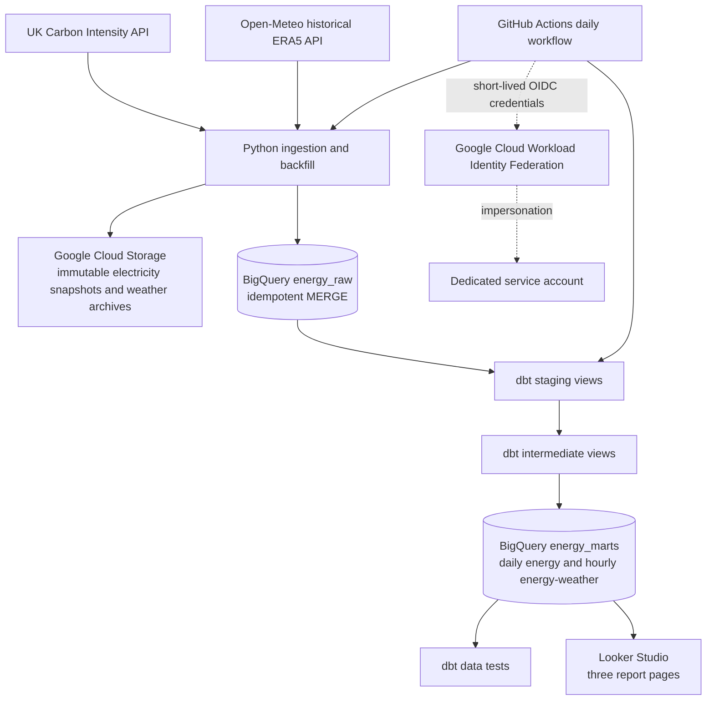
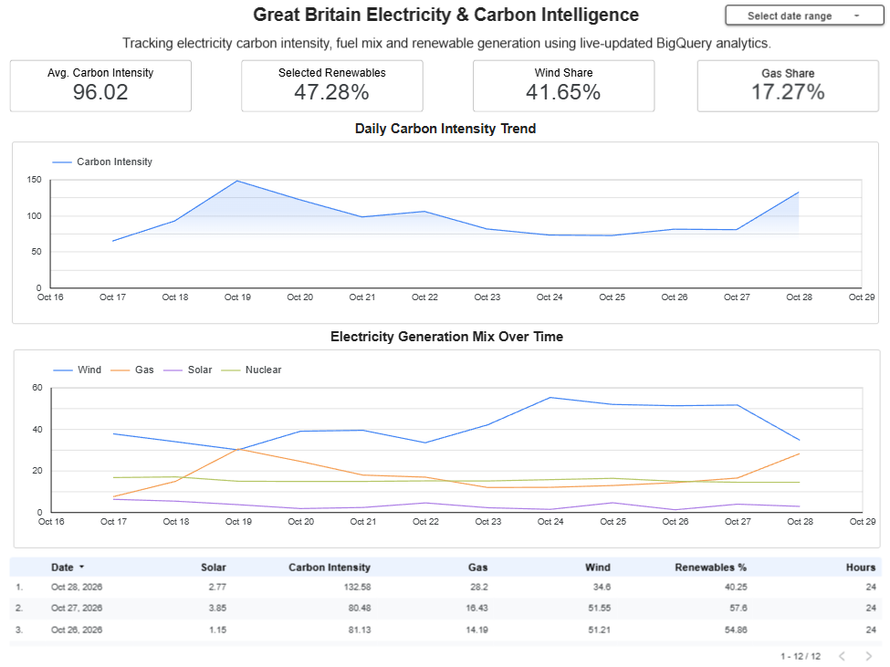
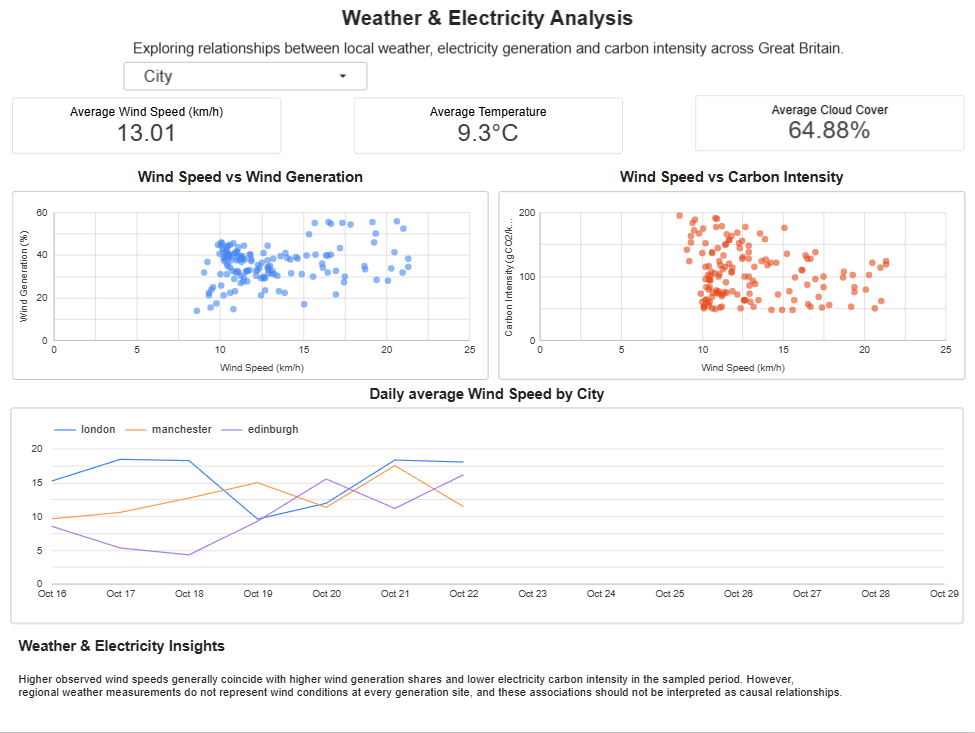
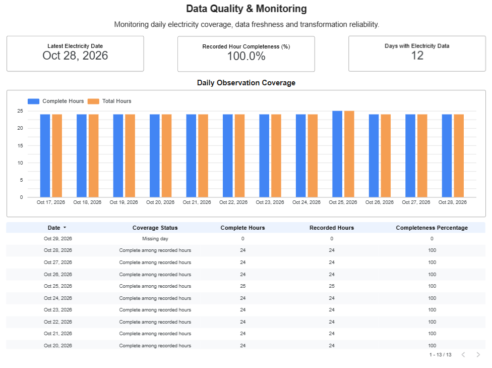

# Great Britain Energy Data Pipeline

**Automated cloud data engineering pipeline for Great Britain's electricity carbon intensity, generation mix, and regional weather.**

**Dashboard Link:** https://datastudio.google.com/reporting/80f6742d-2957-4319-8306-980ae56d8059

[](https://github.com/Mayeed-git/gb-energy-data-pipeline/actions/workflows/energy-pipeline.yml)

**Stack:** Python · REST APIs · Google Cloud Storage · BigQuery · dbt Core · GitHub Actions · Looker Studio

> **Project status:** The incremental workflow has completed successfully on GitHub Actions, and the dbt project has built 8 models and passed 16 tests in a verified run. Current row counts and freshness depend on the latest scheduled execution and upstream data availability.

## Overview

This project implements an end-to-end analytics pipeline that collects electricity and weather observations, archives source responses, loads data to BigQuery with idempotent updates, models analytics datasets with dbt, validates outputs, and presents findings in Looker Studio.

It is designed to explore questions such as:

- How does Great Britain's electricity carbon intensity change over time?
- How do wind, gas, solar, and nuclear generation shares vary by day?
- How do local weather measurements relate to *national* wind generation and electricity carbon intensity?
- Are recorded electricity hours complete, and how fresh is the data?

## Architecture



See [architecture diagram source](docs/architecture.mmd).

## Data sources and grain

| Source | Dataset | Grain | Notes |
| --- | --- | --- | --- |
| [UK Carbon Intensity API](https://carbonintensity.org.uk/) | Carbon intensity | One record per half-hour period | Actual and forecast readings where provided |
| [UK Carbon Intensity API](https://api.carbonintensity.org.uk/) | Generation mix | One fuel-type record per half-hour period | Generation share by source |
| [Open-Meteo Historical Weather API](https://open-meteo.com/en/docs/historical-weather-api) | ERA5 weather | One record per UTC hour per city | London, Manchester, Edinburgh; currently ingested with a seven-day publication safety buffer |

### BigQuery layers

| Layer | Objects | Purpose |
| --- | --- | --- |
| `energy_raw` | `carbon_intensity`, `generation_mix`, `weather` | Ingested source records, including ingestion timestamps and GCS provenance |
| `energy_staging` | 3 staging views and 3 intermediate views | Standardisation, deduplication, fuel-share pivoting, hourly alignment and weather joins |
| `energy_marts` | `fct_daily_energy`, `fct_energy_weather` | Dashboard-ready daily electricity and hourly location-specific analytics |

The `fct_daily_energy` mart contains **one row per UK calendar date**, avoiding triple-counting national electricity metrics across three weather locations. The `fct_energy_weather` mart contains **one row per matched UTC hour per location**, and only includes complete hourly electricity observations.

### Data quality

The dbt project defines **16 tests** across the two marts, including:

- Non-null checks for key dates, locations and measurements.
- Unique date checks on the daily mart and unique hour–location checks on the weather mart.
- Accepted location values.
- Validation of measurement bounds, generation percentages, and hourly period counts.

**Coverage caveat:** `complete_hours / total_hours` measures completeness among *recorded* hours. It does not prove that every expected calendar hour or missing date has been ingested. UK-local days can have 23, 24 or 25 hours because of daylight-saving transitions.

## Automation and security

The workflow at [`.github/workflows/energy-pipeline.yml`](.github/workflows/energy-pipeline.yml) supports manual dispatch and daily scheduled execution. It:

1. Checks out the repository and installs Python dependencies.
2. Authenticates to Google Cloud with GitHub OIDC → Workload Identity Federation → a dedicated service account. No long-lived service account JSON key is stored in the repository.
3. Runs `python -m src.incremental --lookback-days 3`.
4. Refreshes recent electricity dates and a rolling seven-day eligible ERA5 weather window.
5. Executes `dbt build`, rebuilding models and running data tests.

Electricity responses are stored as immutable, uniquely named GCS snapshots, while the weather extractor reuses its archived daily response. BigQuery `MERGE` operations update changed measurements and avoid duplicate business keys.

**Operational limitations:** Historical ERA5 data intentionally lags recent electricity data. Reused weather archives do not automatically incorporate later source revisions; a rolling lookback cannot recover arbitrarily old missed dates; and current mart tests do not replace a complete expected-hour/date-spine check. GitHub Actions run status is not yet stored in BigQuery.

## Dashboard

The Looker Studio report has three pages:

1. **Electricity Overview** — carbon-intensity and generation-share KPIs, daily trends and a details table.
2. **Weather & Electricity Analysis** — city-specific weather KPIs, wind-speed scatter plots and daily wind-speed comparisons.
3. **Data Quality & Monitoring** — electricity freshness, days with data, recorded-hour completeness and a coverage table.

**Report link:**[Explore the Great Britain Electricity & Carbon Intelligence Dashboard](https://datastudio.google.com/reporting/80f6742d-2957-4319-8306-980ae56d8059)

**Screenshots:**

 
  
  

Scatter plots compare city-level wind measurements with *national* generation and carbon intensity. Relationships are exploratory and must not be interpreted as causal.

## Project structure

```text
.
├── .github/workflows/energy-pipeline.yml  # Scheduled and manual orchestration
├── src/
│   ├── incremental.py                      # Recent electricity and delayed weather loads
│   ├── backfill.py                         # Historical electricity backfill
│   ├── ingestion/                          # API extractors and weather backfill
│   ├── storage/                            # GCS utilities
│   └── warehouse/                          # BigQuery utilities
├── energy_analytics/
│   ├── models/staging/                     # Source staging models
│   ├── models/intermediate/                # Hourly alignment and generation transforms
│   ├── models/marts/                       # Two analytics fact tables
│   ├── tests/                              # Custom dbt tests
│   ├── macros/                             # Dataset naming macro
│   └── dbt_project.yml
├── docs/
│   ├── architecture.mmd
│   └── screenshots/
└── requirements.txt
```

## Run locally

**Prerequisites:** Python 3.13-compatible environment, Google Cloud project access, a GCS bucket and three BigQuery datasets in `us-central1`, and Google Application Default Credentials with relevant permissions. Cloud resource names currently default to the author's project in the Python scripts and dbt configuration; change them to use your own project before running.

In PowerShell from the repository root:

```powershell
python -m venv .venv
.\.venv\Scripts\Activate.ps1
python -m pip install -r requirements.txt

# Authenticate for local development (requires Google Cloud CLI)
gcloud auth application-default login

# Fetch recent data, load to BigQuery, then run dbt build and tests
python -m src.incremental --lookback-days 3
```

To run only the dbt transformation and tests:

```powershell
cd energy_analytics
dbt build
```

The repository's `energy_analytics/profiles.yml` is designed for cloud Application Default Credentials. Ensure that your selected profile, dataset and location match the target environment.

## Further improvements

- Implement expected UK-local hourly calendar coverage and missing-date monitoring in dbt.
- Add late-arriving/revised weather-data refresh strategy and durable pipeline watermarks.
- Persist workflow execution metadata and test outcomes for genuine operational monitoring.
- Move resource identifiers to environment configuration and replace beta dependency pins with verified stable versions.
- Add unit/integration tests for API failures, partial periods, and daylight-saving boundaries.

## Source code

Repository: [Mayeed-git/gb-energy-data-pipeline](https://github.com/Mayeed-git/gb-energy-data-pipeline)
